# Database Design and ERD

SQL Server, EF Core 8 code-first. Migrations: `NotificationGateway.Infrastructure/Migrations`.

## 1. ERD

```mermaid
erDiagram
    Tenants ||--o{ TenantChannelSettings : "enables"
    Tenants ||--o{ TenantProviderConfigurations : "owns (NULL = shared)"
    NotificationProviders ||--o{ TenantProviderConfigurations : "product of"
    TenantProviderConfigurations ||--|| ProviderHealth : "circuit state"
    TenantProviderConfigurations ||--o{ ChannelProviderAssignments : "used in chain"
    Tenants ||--o{ ChannelProviderAssignments : "primary + fallbacks"
    Tenants ||--o{ NotificationTemplates : "owns (NULL = shared)"
    Tenants ||--o{ NotificationRoutingRules : "defines"
    Tenants ||--o{ NotificationUserPreferences : "users of"
    Tenants ||--o{ NotificationQuotas : "limited by"
    Tenants ||--o{ NotificationQuotaUsages : "consumes"
    Tenants ||--o{ NotificationWebhooks : "receives receipts"
    TenantProviderConfigurations ||--o{ NotificationWebhooks : "callbacks for"
    Tenants ||--o{ Notifications : "sends"
    Notifications ||--o{ NotificationRecipients : "to"
    Notifications ||--o{ NotificationDeliveries : "one per recipient x channel"
    NotificationRecipients ||--o{ NotificationDeliveries : "delivered via"
    NotificationDeliveries ||--o{ NotificationDeliveryAttempts : "history"
    NotificationDeliveries ||--o| InAppNotifications : "InApp row"
    Tenants ||--o{ OutboxMessages : "events"
    Tenants ||--o{ AuditLogs : "changes"

    Tenants { uniqueidentifier Id PK  nvarchar Code UK  nvarchar Name  bit IsActive  int DefaultLanguage  nvarchar TimeZoneId  bit CriticalOverridesUserPreferences  int QuotaExceededPolicy  int RequestsPerMinute }
    NotificationProviders { nvarchar Key PK  nvarchar Channel  nvarchar DisplayName  int Capabilities  bit IsEnabled  decimal EstimatedCostPerMessage  nvarchar CostCurrency }
    TenantProviderConfigurations { uniqueidentifier Id PK  uniqueidentifier TenantId FK "NULL = shared"  nvarchar ProviderKey FK  nvarchar Channel  nvarchar Name  nvarchar SettingsJson  nvarchar EncryptedSecrets "AES-GCM envelope"  int SecretVersion  nvarchar SenderIdentity  bit IsActive  rowversion RowVersion }
    ProviderHealth { uniqueidentifier ProviderConfigurationId PK,FK  int State  int ConsecutiveFailures  datetimeoffset OpenUntil  bigint TotalCalls  bigint TotalFailures  bigint TotalLatencyMs }
    TenantChannelSettings { uniqueidentifier Id PK  uniqueidentifier TenantId FK  nvarchar Channel  bit IsEnabled  int MaxAttempts  int BaseRetryDelaySeconds  int MaxRetryDelaySeconds  int ProviderTimeoutSeconds }
    ChannelProviderAssignments { uniqueidentifier Id PK  uniqueidentifier TenantId FK  nvarchar Channel  uniqueidentifier ProviderConfigurationId FK  int Order "0 = primary" }
    NotificationTemplates { uniqueidentifier Id PK  uniqueidentifier TenantId FK "NULL = shared"  nvarchar Code  nvarchar Channel  int Language  int Version  nvarchar Subject  nvarchar Body  bit IsActive }
    NotificationRoutingRules { uniqueidentifier Id PK  uniqueidentifier TenantId FK  nvarchar Name  nvarchar NotificationType  int MinPriority  nvarchar Channels  int Order  bit AllowCallerOverride  bit IsActive }
    NotificationUserPreferences { uniqueidentifier Id PK  uniqueidentifier TenantId FK  nvarchar UserId  int Language  nvarchar PreferredChannels  nvarchar DisabledChannels  nvarchar DisabledNotificationTypes  time QuietHoursStart  time QuietHoursEnd  nvarchar TimeZoneId  bit AllowCriticalOverride }
    NotificationQuotas { uniqueidentifier Id PK  uniqueidentifier TenantId FK  nvarchar Channel "NULL = all"  int Period  bigint Limit }
    NotificationQuotaUsages { uniqueidentifier TenantId PK  nvarchar ChannelKey PK  nvarchar PeriodKey PK  bigint Used }
    NotificationWebhooks { uniqueidentifier Id PK  uniqueidentifier TenantId FK  uniqueidentifier ProviderConfigurationId FK  nvarchar ProviderKey  nvarchar PublicToken UK  nvarchar EncryptedSigningSecret  nvarchar PreviousEncryptedSigningSecret  datetimeoffset PreviousSecretValidUntil  bit IsActive }
    ProcessedWebhookEvents { bigint Id PK  nvarchar ProviderKey  nvarchar EventId  uniqueidentifier TenantId  datetimeoffset ReceivedAt }
    Notifications { uniqueidentifier Id PK  uniqueidentifier TenantId FK  nvarchar IdempotencyKey  nvarchar RequestHash  nvarchar NotificationType  nvarchar TemplateCode  int Priority  nvarchar DataJson  nvarchar CorrelationId  nvarchar RequestedBy  datetimeoffset CreatedAt }
    NotificationRecipients { uniqueidentifier Id PK  uniqueidentifier TenantId  uniqueidentifier NotificationId FK  nvarchar UserId  nvarchar Email  nvarchar Phone  nvarchar DeviceToken  int Language }
    NotificationDeliveries { uniqueidentifier Id PK  uniqueidentifier TenantId  uniqueidentifier NotificationId FK  uniqueidentifier RecipientId FK  nvarchar Channel  int Status  int Priority  int AttemptCount  int MaxAttempts  int ProviderIndex  int RetryRound  datetimeoffset NextAttemptAt  nvarchar LockedBy  datetimeoffset LockedUntil  uniqueidentifier InFlightProviderConfigurationId  uniqueidentifier LastProviderConfigurationId  nvarchar ProviderMessageId  nvarchar Subject  nvarchar Body  rowversion RowVersion }
    NotificationDeliveryAttempts { uniqueidentifier Id PK  uniqueidentifier TenantId  uniqueidentifier DeliveryId FK  int AttemptNumber  uniqueidentifier ProviderConfigurationId  nvarchar ProviderKey  nvarchar Outcome  nvarchar ProviderMessageId  nvarchar ErrorCode  int HttpStatus  datetimeoffset StartedAt  bigint DurationMs }
    InAppNotifications { uniqueidentifier Id PK  uniqueidentifier TenantId FK  nvarchar UserId  uniqueidentifier DeliveryId UK  nvarchar Title  nvarchar Body  bit IsRead }
    OutboxMessages { uniqueidentifier Id PK  uniqueidentifier TenantId  nvarchar Type  nvarchar Payload  datetimeoffset OccurredAt  datetimeoffset ProcessedAt  int Attempts  datetimeoffset LockedUntil }
    AuditLogs { bigint Id PK  uniqueidentifier TenantId  nvarchar UserId  nvarchar EntityType  nvarchar EntityId  nvarchar Action  nvarchar ChangesJson "secrets redacted"  datetimeoffset At }
```



(Column lists show the important columns; see the migration for the full definition.)

## 2. Spec entity names → tables

| Spec (§7) | Table(s) |
|---|---|
| Tenants | `Tenants` |
| NotificationProviders | `NotificationProviders` (catalog, synced from the adapters at startup) |
| TenantProviderConfigurations | `TenantProviderConfigurations` + `ProviderHealth` |
| NotificationChannels | `TenantChannelSettings` (per-tenant activation/policy) + `ChannelProviderAssignments` (chain); channels themselves are an enum |
| NotificationTemplates | `NotificationTemplates` |
| NotificationRoutingRules | `NotificationRoutingRules` |
| Notifications / NotificationRecipients | `Notifications`, `NotificationRecipients`, `NotificationDeliveries` |
| NotificationDeliveryAttempts | `NotificationDeliveryAttempts` |
| NotificationUserPreferences | `NotificationUserPreferences` |
| NotificationWebhooks | `NotificationWebhooks` |
| NotificationQuotas | `NotificationQuotas` + `NotificationQuotaUsages` (atomic counters) |
| ProcessedWebhookEvents | `ProcessedWebhookEvents` |
| (extra) | `InAppNotifications`, `OutboxMessages`, `AuditLogs` |

## 3. Keys, relationships and tenant isolation in the schema

- Every tenant-owned row has `TenantId` (FK → `Tenants`, `ON DELETE RESTRICT`: tenants are deactivated, never cascaded away).
- `Notifications`, `NotificationRecipients`, `NotificationDeliveries` expose an alternate key `(TenantId, Id)`.
  Children reference it with **composite foreign keys**:
  `Recipients(TenantId, NotificationId)`, `Deliveries(TenantId, NotificationId)`, `Deliveries(TenantId, RecipientId)`,
  `Attempts(TenantId, DeliveryId)`. A row of tenant B can never point at a parent of tenant A, even through raw SQL.
- Shared rows use `TenantId = NULL` (provider configurations, templates). Only SystemAdmin can write them (write guard).
- Optimistic concurrency: `rowversion` on `NotificationDeliveries` and `TenantProviderConfigurations`.

## 4. Unique constraints (business rules enforced by the database)

| Constraint | Rule |
|---|---|
| `Tenants(Code)` | Tenant codes are unique |
| `Notifications(TenantId, IdempotencyKey) WHERE IdempotencyKey IS NOT NULL` | **Idempotency** (T11), also under concurrency |
| `NotificationDeliveries(NotificationId, RecipientId, Channel)` | One delivery per recipient per channel |
| `NotificationDeliveryAttempts(DeliveryId, AttemptNumber)` | Ordered attempt history |
| `InAppNotifications(DeliveryId)` | A retried InApp delivery cannot create a second inbox item |
| `TenantChannelSettings(TenantId, Channel)` | One policy per channel |
| `ChannelProviderAssignments(TenantId, Channel, Order)` and `(TenantId, Channel, ProviderConfigurationId)` | One primary, ordered fallbacks, no duplicates |
| `NotificationTemplates(TenantId, Code, Channel, Language, Version)` | Immutable versions |
| `NotificationUserPreferences(TenantId, UserId)` | One preference row per user per tenant |
| `NotificationQuotas(TenantId, Channel, Period)` | One quota per scope |
| `NotificationWebhooks(PublicToken)` | Unguessable callback URL resolves to exactly one tenant/config |
| `ProcessedWebhookEvents(ProviderKey, EventId)` | **Replay protection** |

## 5. Indexing strategy

| Index | Serves |
|---|---|
| `NotificationDeliveries(Status, NextAttemptAt)` | Dispatcher lease query (due Queued/Retrying rows) |
| `IX_Deliveries_Lease (Status, LockedUntil)` | Expired-lease recovery |
| `NotificationDeliveries(LastProviderConfigurationId, ProviderMessageId) WHERE ProviderMessageId IS NOT NULL` | Matching webhook receipts |
| `NotificationDeliveries(TenantId, CreatedAt) INCLUDE (Channel, Status, LastProviderKey)` | Reports by channel/status/provider |
| `NotificationDeliveryAttempts(TenantId, StartedAt) INCLUDE (ProviderKey, Outcome, DurationMs)` | Provider performance/cost reports |
| `Notifications(TenantId, CreatedAt)`, `(TenantId, NotificationType, CreatedAt)` | History with filters |
| `InAppNotifications(TenantId, UserId, IsRead, CreatedAt)` | Inbox / unread count |
| `IX_Outbox_Pending (ProcessedAt, OccurredAt) WHERE ProcessedAt IS NULL` | Outbox relay |
| `NotificationRoutingRules(TenantId, IsActive, Order)` | Routing |
| `NotificationTemplates(Code, Channel, Language, IsActive)` | Template resolution |
| `ProcessedWebhookEvents(ReceivedAt)` | Retention clean-up |
| `AuditLogs(TenantId, At)` | Audit queries |

The lease query uses `WITH (UPDLOCK, READPAST, ROWLOCK)` on the `(Status, NextAttemptAt)` index so concurrent dispatchers
skip each other's rows instead of blocking.

## 6. Sensitive data

- Provider credentials and webhook signing secrets: **AES-256-GCM envelopes** (`v1:<keyId>:<nonce>:<ciphertext+tag>`),
  additional authenticated data = `provider-config:<id>` / `webhook:<id>`. Never plain text, never in `AuditLogs`
  (the audit builder redacts `EncryptedSecrets`/`*Secret*` properties).
- Recipient addresses are stored for delivery and masked in API responses.

## 7. Migration scripts

```powershell
# create/upgrade the database
dotnet ef database update -p NotificationGateway.Infrastructure -s Multi_Tenant_Notification_Gateway

# idempotent SQL script for DBAs (deliverable)
dotnet ef migrations script --idempotent -p NotificationGateway.Infrastructure -s Multi_Tenant_Notification_Gateway -o docs/sql/NotificationGateway_migrations.sql
```

Migrations: `InitialCreate`, `AddPreferredChannels`.
