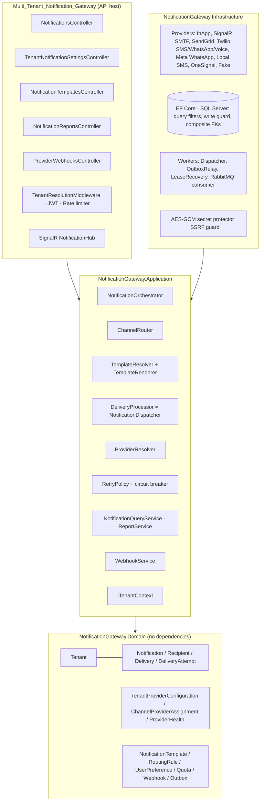
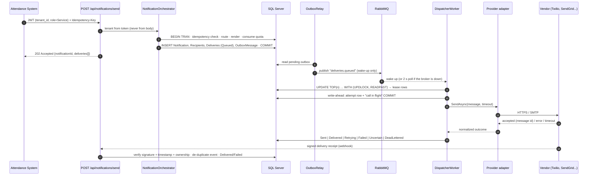

# Multi-Tenant Notification Gateway — Architecture

**Project:** Attendance System — الجهاز المركزي للتعمير · **Task 8** · .NET 8 · SQL Server · RabbitMQ · SignalR

## 1. Goal

A reusable notification gateway, not an e-mail/SMS sender. Business modules (the Attendance System first) send
*"notify these people about this event"*. The gateway decides **which channels**, **which provider product per channel**,
**which template and language**, delivers asynchronously, retries and fails over safely, and keeps a per-tenant history.

- A new **tenant** is onboarded by configuration only (API calls).
- A new **provider product** is one adapter class plus one DI line. The engine does not change.

## 2. Solution layout (Clean Architecture)

Dependency rules are enforced by `NotificationGateway.ArchitectureTests` (NetArchTest): Domain depends on nothing,
Application does not reference Infrastructure or ASP.NET Core, provider SDK/HTTP details live only in Infrastructure.

### Mapping to the suggested components (spec §4)

| Suggested | Implemented as | Notes |
|---|---|---|
| NotificationOrchestrator | `NotificationOrchestrator` | Accept path: validation, idempotency, routing, rendering, quotas, outbox — one transaction |
| NotificationRouter | `ChannelRouter` | Rules → channels; tenant channel activation always wins |
| NotificationDispatcher | `DeliveryProcessor` + `DispatcherWorker` | Leased, one delivery at a time, provider chain with fallback |
| TemplateEngine | `TemplateResolver` + `TemplateRenderer` | Tenant → shared, requested language → tenant default; placeholders only (no code execution) |
| ProviderResolver | `ProviderResolver` + `IProviderRegistry` | Dictionary lookup by provider key, **no switch statements** |
| RetryService | `RetryPolicy` + `ProviderHealth` (circuit breaker) | Exponential backoff with jitter; open circuits are skipped |
| TenantContext | `ITenantContext` / `TenantContext` | Set once per request from the validated JWT; scoped for workers |
| NotificationSubscription | `NotificationUserPreference` + `NotificationWebhook` | User opt-in/out per channel/type; provider callback subscriptions |
| BackgroundJobs | `Workers/*` | Hosted services; can be switched off per instance |

`NotificationService` was deliberately **not** used as a god class (spec §12): commands (orchestrator), queries
(query service), dispatching (processor), routing, templates and webhooks are separate, individually testable classes.

## 3. Request flow (accept → dispatch → receipt)

Key properties:

- **The caller never waits for a vendor.** The API commits and returns 202; delivery is asynchronous.
- **Nothing is lost** if publishing fails: the outbox row is in the same transaction as the notification.
  RabbitMQ is only a wake-up signal; the delivery row is the source of truth, so a lost or duplicated message is harmless.
- **Survives restarts:** queued rows are picked up by any instance; expired leases are recovered (§5 of the routing doc).

## 4. Key design decisions and trade-offs

| Decision | Why | Trade-off |
|---|---|---|
| One **delivery row per (recipient, channel)** with its own state machine | Channels fail independently; retries/fallback per channel; exact history | More rows than one-row-per-notification |
| **Snapshot rendered content** on the delivery at accept time | A template edit never changes an already accepted message; retries send identical content | Storage |
| **SQL leasing (UPDLOCK + READPAST)** instead of broker-only competing consumers | Works on N instances with no extra coordination, ordering by priority, crash recovery by lease expiry | DB load at very high volume (mitigated by indexes, batch size) |
| **RabbitMQ as wake-up**, DB as source of truth | Low latency without making the broker critical | Two moving parts |
| **Uncertain** state, no failover after an ambiguous timeout | Avoids duplicate SMS/WhatsApp to citizens | Some messages need manual/receipt resolution |
| Provider **capabilities flags** (receipts, idempotency key, synchronous, sender identity) | Spec: do not assume all providers behave the same | Each adapter must declare them honestly |
| **Envelope encryption** per configuration (AES-256-GCM, AAD = row id) | A ciphertext copied to another tenant's row cannot be decrypted | Key management in configuration/KMS |
| Placeholder-only templates (`{{Name}}`) | Tenant-authored templates can never execute code | No loops/conditions (Scriban templates from the Attendance System were simplified) |
| Tenant from **token only**; route/body tenant ids are validated, never trusted | Spec §6 | Admin impersonation needs an explicit header/route and is audited |

## 5. Scaling and multiple instances

- API instances are stateless; any number can run behind a load balancer.
- Dispatchers can run in the API process or in dedicated worker instances (`Workers:Enabled`). Leasing guarantees one
  dispatcher per delivery at a time; `LeaseSeconds` > provider timeout.
- Throughput knobs: `Workers:BatchSize`, `Workers:Parallelism`, provider timeouts, number of worker instances.
- Fairness: per-tenant API rate limit (`Tenant.RequestsPerMinute`), per-tenant daily/monthly quotas, per-provider
  circuit breaker. Leasing orders by `Priority DESC, NextAttemptAt` so critical alerts are not stuck behind bulk sends.
- SignalR on several instances needs a backplane (Azure SignalR Service or Redis) — configuration only, no code change.

## 6. Mandatory technical discussion — short answers

| Question | Answer |
|---|---|
| One notification, three channels, no duplicated logic? | Orchestrator creates one delivery per channel; the same dispatcher processes each; only the adapter differs. |
| Tenant A on SendGrid, tenant B on SMTP? | Each tenant's Email chain points at its own `TenantProviderConfiguration` (or a shared one). Resolution is data, not code. |
| Prevent A reading B's history? | Tenant from JWT; route tenant must match (403); EF global query filters on every tenant-owned table (404 for foreign ids); write guard on SaveChanges; composite FKs (TenantId, Id). |
| Provider accepted but the response timed out? | Delivery becomes **Uncertain**; no failover (could duplicate). Resolved by delivery receipt, or retried on the same provider only if it de-duplicates by our idempotency key. |
| Prevent duplicate delivery during retries? | Idempotency-Key on the API; unique (NotificationId, RecipientId, Channel); write-ahead attempt row; lease ownership; provider idempotency keys where supported; InApp unique per delivery. |
| Primary provider unavailable? | Transient/provider failures fall back immediately to the next provider in the chain; circuit breaker skips it while open; whole chain failing → backoff retry → dead letter. |
| Add a provider without modifying the core? | Implement `INotificationProvider` (+ optional `IProviderWebhookHandler`), register it. The catalog syncs at startup. |
| Manage and rotate credentials? | Write-only API, AES-GCM envelopes bound to the row, `SecretVersion` increments, master keys in config/KMS with key ids, re-encrypt endpoint after master-key rotation. |
| Thousands of notifications across tenants? | Async accept, batched leasing, parallel dispatch, horizontal workers, indexes for the lease query, per-tenant limits. |
| One tenant consuming all resources? | Rate limit per tenant partition, quotas (Reject or Defer), priority ordering, bounded parallelism. |
| Sent vs Delivered? | Sent = vendor accepted. Delivered only from a receipt/callback or a channel that proves it (InApp row persisted). |
| Multiple API instances? | Stateless API, DB leasing, outbox relay is idempotent, SignalR backplane. |
| Provider-specific webhooks? | One handler per provider (signature + parsing); URL carries an unguessable per-tenant token; events de-duplicated. |
| Queued and the app restarts? | Rows stay Queued in SQL and are leased by the next instance; in-flight rows are recovered when the lease expires. |
| Migrate provider products without affecting tenants? | Add the new configuration, put it first in that tenant's chain (old one as fallback), watch the provider report, remove the old one. Per tenant, zero downtime. |
