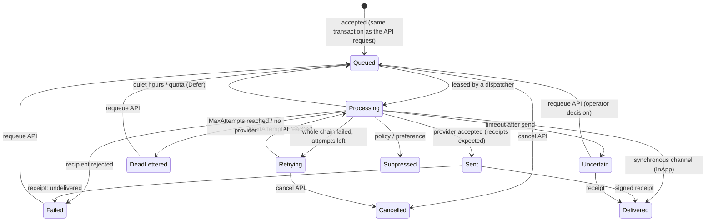

# Notification Routing and Fallback

Two independent decisions:

1. **Routing** (accept time) — *which channels* a notification uses → `ChannelRouter`.
2. **Provider selection and fallback** (dispatch time) — *which provider* delivers each channel → `ProviderResolver` + `DeliveryProcessor`.

## 1. Channel routing

For every request:

1. Load the tenant's active routing rules ordered by `Order` (ascending). The first rule whose
   `NotificationType` (exact, case-insensitive, or null = any) and `MinPriority` (null = any) match wins.
2. If the rule has `AllowCallerOverride = true` and the caller passed `channels`, use the caller's channels; otherwise the rule's channels.
   No matching rule → the caller's channels.
3. **Tenant policy always wins:** channels the tenant has not enabled are removed and reported as warnings in the 202 response.
4. One delivery is created per (recipient, channel) when the recipient has an address for that channel
   (InApp/SignalR → userId, Email → email, SMS/WhatsApp/Voice → phone, Push → deviceToken).

Examples matching spec §5.D (the demo seed creates the first two):

| Rule (Order) | Matches | Channels | Caller override |
|---|---|---|---|
| Critical → every channel (10) | any type, priority ≥ Critical | InApp, SignalR, Email, SMS | No |
| Late arrival (20) | `attendance.late` | InApp, SignalR, Email | Yes |
| General announcements (30) | `announcement` | InApp, Push | Yes |
| External (40) | `external.notice` | WhatsApp, Email | No |
| Default (1000) | anything | InApp | Yes |

## 2. User preferences and policies (dispatch time)

Applied by `DeliveryProcessor` right before calling a provider, in this order:

| Check | Result |
|---|---|
| Tenant inactive or channel disabled by the tenant | **Suppressed** |
| User opted out of the channel or the notification type | **Suppressed** (unless critical override) |
| User has preferred channels, this channel is not one of them, and the same notification reaches the user on a preferred channel | **Suppressed** (InApp is always kept) |
| Inside the user's quiet hours (user time zone, else tenant time zone; windows may cross midnight) | **Deferred** to the end of the window (not for InApp) |

**Critical override:** `Priority = Critical` AND `Tenant.CriticalOverridesUserPreferences` AND the user did not refuse
overrides (`AllowCriticalOverride`) → opt-outs, preferred channels and quiet hours are ignored. Tenant channel activation
is never overridden.

Preferences are evaluated at dispatch time (not accept time) so a change made after the request is still respected.

## 3. Provider chain

Per tenant and channel, `ChannelProviderAssignments` holds an ordered chain: `Order 0` = primary, `1..n` = fallbacks.
Entries can be the tenant's own configurations or shared platform configurations. A configuration is skipped when it is
inactive, disabled in the catalog, has no adapter in this build, or its **circuit breaker is open**.

## 4. When does fallback happen? (spec §5.D "Important")

| Event during an attempt | Outcome | Fallback to next provider? | Retry later? | Why |
|---|---|---|---|---|
| Connection refused / DNS failure / blocked before sending | TransientFailure | **Yes, immediately** | Yes | Nothing reached the provider |
| HTTP 429 / 5xx | TransientFailure | **Yes, immediately** | Yes | Provider is overloaded/down |
| HTTP 401/403, bad credentials, missing sender | ProviderFailure | **Yes, immediately** | Yes | This provider's configuration is broken |
| Invalid/unsubscribed recipient (e.g. Twilio 21211, Meta 131026) | RecipientRejected | **No** → Failed | No | Any provider would reject the same address |
| **Timeout after the request was sent**, connection lost mid-request | Uncertain | **No** → Uncertain | Only same provider *if* it de-duplicates by our idempotency key | The message may already be delivered: a second provider could send a duplicate |
| Accepted, later a receipt says *undelivered/failed* | Delivery-status failure | **No automatic fallback** → Failed | No | The vendor already tried; re-sending through another vendor is a business decision (requeue from the dead-letter API) |
| Accepted, receipt says delivered | Delivered | — | — | — |

So: **fallback happens on provider failures (transient or configuration), never on uncertain results and never after a
delivery-status failure.** This is the rule that prevents duplicate messages.

## 5. Retries, backoff, dead letters, recovery

- **One round** = walk the chain from the current provider; every real provider call counts as one attempt
  (`AttemptCount`), skipped providers (open circuit) do not.
- After a failed round: `NextAttemptAt = now + min(base × 2^(round-1), max) ± 20 % jitter`
  (per tenant channel: `BaseRetryDelaySeconds`, `MaxRetryDelaySeconds`). Jitter avoids retry storms after an outage.
- `AttemptCount ≥ MaxAttempts` → **DeadLettered**, visible in `GET /api/tenants/{tenantId}/dead-letters`, replayable with
  `POST …/dead-letters/{deliveryId}/requeue` (fresh attempt budget).
- **Timeouts:** every provider call runs under `ProviderTimeoutSeconds` (per tenant channel). A timeout is treated as Uncertain.
- **Circuit breaker:** `FailureThreshold` consecutive failures → Open for `OpenSeconds` → Half-open (one trial call) → Closed on success.
- **Cancellation:** `POST /api/notifications/{id}/cancel` cancels deliveries not yet handed to a provider.

## 6. Duplicate prevention (what is and is not guaranteed)

We do **not** claim exactly-once delivery to a phone. We guarantee:

| Mechanism | Prevents |
|---|---|
| `Idempotency-Key` + unique index `(TenantId, IdempotencyKey)` + request hash | The caller's retries creating a second notification (same key + different body → 409) |
| Unique `(NotificationId, RecipientId, Channel)` | Two deliveries for the same recipient/channel |
| SQL lease (`UPDLOCK, READPAST`) + `LockedBy` check + `rowversion` | Two dispatchers processing the same delivery |
| **Write-ahead attempt**: "call in flight" committed *before* the provider call | After a crash we know a call may have happened → Uncertain, not a blind resend |
| No failover on Uncertain | A second provider sending the same message |
| Provider idempotency keys (OneSignal, InApp unique per delivery) | Duplicates when the same provider is retried |
| `ProcessedWebhookEvents(ProviderKey, EventId)` | A replayed receipt changing state twice |

Remaining risk (documented, inherent to SMS/WhatsApp vendors without idempotency): a crash or timeout *after* the vendor
accepted. These deliveries are marked **Uncertain** for receipt-based or manual resolution instead of being re-sent.

## 7. Crash and restart recovery

- Queued/Retrying rows live in SQL → picked up by any instance after a restart (T12).
- A worker that dies holding a lease: `LeaseRecoveryWorker` finds `Status = Processing AND LockedUntil < now`.
  No call in flight → back to the queue. Call in flight → **Uncertain** (or retry on the same provider when it supports
  idempotency keys). Dangling attempt rows are closed with `worker_crashed`.
- Outbox rows not yet published are retried by the relay; RabbitMQ unavailability only adds polling latency.
